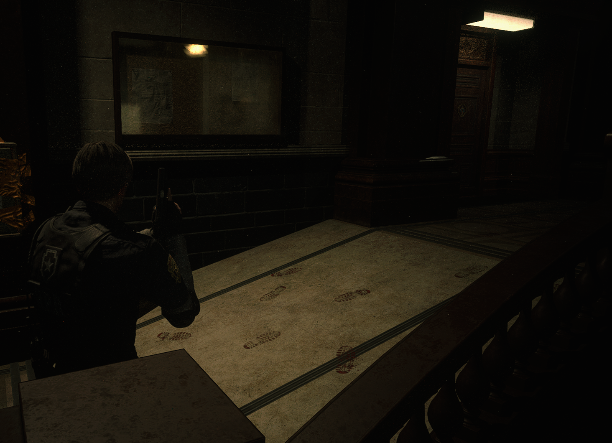
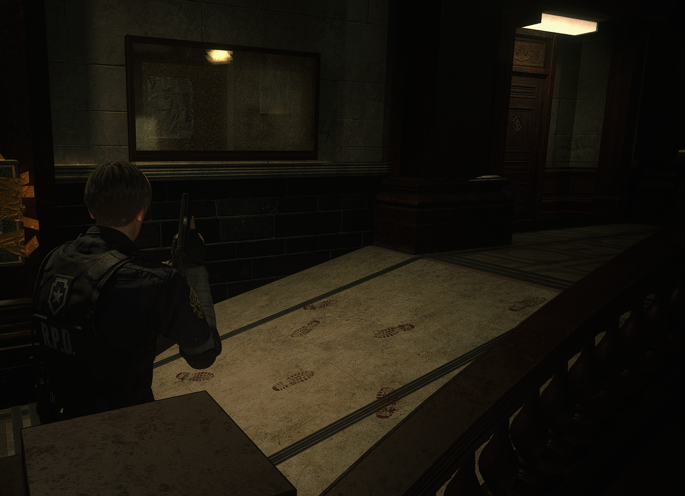
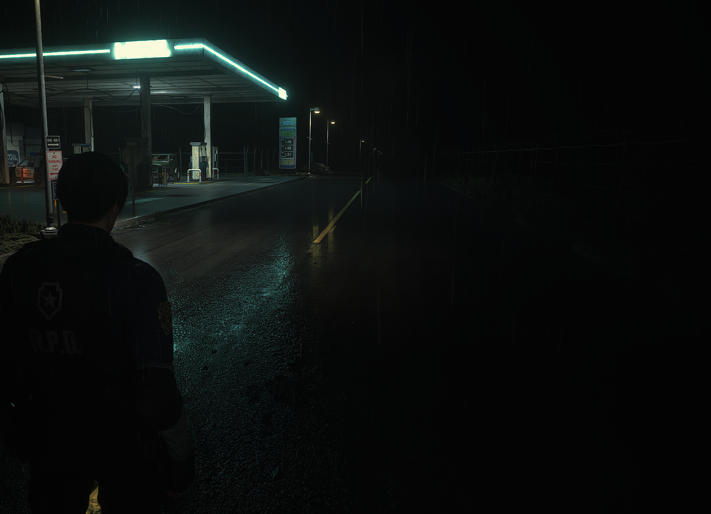
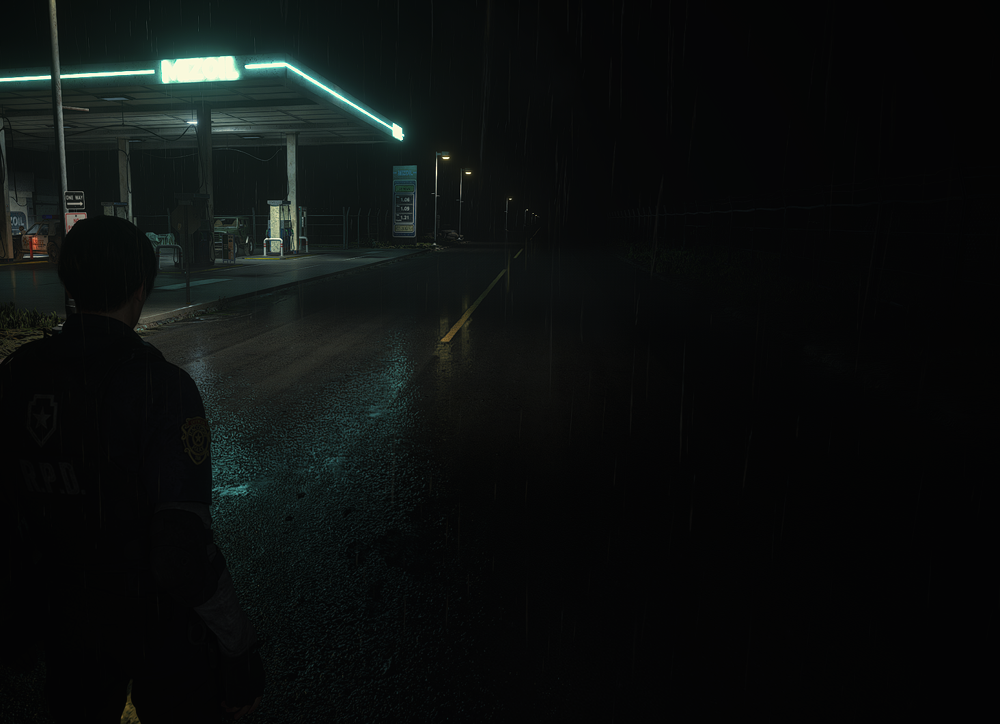

# REFramework-RayReconstruction

A fork of [REFramework](https://github.com/praydog/REFramework), by praydog, for Resident Evil 2. It adds NVIDIA DLSS Ray Reconstruction to the game's path tracing, and fixes a bug of that path tracer that floods emissive signs.

**Experimental, and only for RE2.** One person tested it, on the Steam build 11636119, and judged Ray Reconstruction in one scene. RE3, RE4, RE7 and RE8 are not supported.

- [What it fixes](#what-it-fixes)
- [Requirements](#requirements)
- [Installation](#installation)
- [Turning it on](#turning-it-on)
- [Limits](#limits)
- [Uninstalling](#uninstalling)
- [Building](#building)
- [Reporting a bug](#reporting-a-bug)
- [Credits and licenses](#credits-and-licenses)

## What it fixes

Two separate things: a new feature, and a bug of the game.

### Ray Reconstruction, a new feature

RE2 has a hidden path tracer, Pure Path Tracing, that REFramework can turn on. Its image is noisy, and its only denoiser is the game's TAA, which leaves much of the noise and loses light.

The RayReconstruction Mod replaces that TAA with DLSS Ray Reconstruction, as DLAA: at the game's render resolution, without upscaling.

| The game's TAA | Ray Reconstruction |
|---|---|
|  |  |

*The corridor of the police station, in Pure Path Tracing at 4 samples per pixel. Click an image to see it at full size.*

### The doubled emission, a bug of the game

RE2's path tracer counts twice the light that a bounce finds on an emissive surface. The game's own ray tracing counts it once, so it looks like a bug. The TAA hides it by clipping bright light, but Ray Reconstruction keeps that light, and signs flood, as at the gas station. The bug is the path tracer's, not Ray Reconstruction's.

The EmissionCorrection Mod fixes it in memory, without touching the game's files, for 48 variants of Pure Path Tracing. It works with or without Ray Reconstruction.

| Without the correction | With the correction |
|---|---|
|  |  |

*The gas station, in Pure Path Tracing at 4 samples per pixel, with Ray Reconstruction on in both.*

## Requirements

- An NVIDIA RTX GPU, with a driver that supports DLSS Ray Reconstruction.
- Resident Evil 2 on Steam, build 11636119: the version with ray tracing, on DirectX 12. The build is the `buildid` in `steamapps\appmanifest_883710.acf`.
- Windows 10 1803 or later, for `install_rr_snippet.bat`.

The Mods recognise the game's shaders by digests taken from build 11636119. On another build, Ray Reconstruction may stay off with a warning, and the correction may say "no correction for this variant". That is not a bug: the Mods need the digests of that build.

## Installation

1. Close the game. If you use the official REFramework, back up its `dinput8.dll`: this fork replaces it.
2. Extract the zip of the latest [release](https://github.com/jusangar/REFramework-RayReconstruction/releases) into the game's folder, next to `re2.exe`. It contains:

   ```text
   dinput8.dll
   install_rr_snippet.bat
   reframework\rr\NVIDIA_RTX_SDKs_LICENSE.txt
   reframework\rr\REFramework-RayReconstruction_LICENSE.txt
   reframework\rr\rr_bridge.dll
   reframework\rr\rr_bridge_NOTICE.txt
   ```

3. Run `install_rr_snippet.bat` from there. It downloads `nvngx_dlssd.dll`, the snippet of Ray Reconstruction, from NVIDIA's own repository, [NVIDIA/DLSS](https://github.com/NVIDIA/DLSS), checks its SHA-256 and puts it in `reframework\rr\`. It never replaces an `nvngx_dlssd.dll` that is already there.

The release cannot include the snippet, because it belongs to NVIDIA. To install it by hand instead:

1. Download https://github.com/NVIDIA/DLSS/raw/v310.9.16/lib/Windows_x86_64/rel/nvngx_dlssd.dll
2. Check that `certutil -hashfile nvngx_dlssd.dll SHA256` gives `b49435ae346f227feafe7bbe937d88277ea0ee7323975ec06488f377fdb46cee`.
3. Put it in `reframework\rr\`.

The Mods themselves never connect to the internet.

## Turning it on

1. In the game's graphics options, set anti-aliasing to **TAA**: everything was validated with it, on DirectX 12 and with the game's ray tracing on. The option that combines FXAA and TAA is not supported.
2. Open the menu of REFramework with the Insert key.
3. In **Graphics**, under **Ray Tracing Tweaks**, tick **Enable Ray Tracing Tweaks**. Set **Ray Trace Type** to **Pure Path Tracing**, and the three **Ray Trace Clone Type** options to **Disabled**.
4. In **RayReconstruction**, tick **Enabled**, which is off by default. **Switch key** can turn it on and off, to compare it with the TAA.
5. **EmissionCorrection** is on by default.

The section **RayReconstruction** then shows:

- **Availability:** "available" once you are in the game.
- **RR snippet:** which snippet runs, where it comes from and its version.
- **Game settings:** a yellow line under it points at a setting that is not right.

Leave the folded sections as they are: they are for development.

<details>
<summary>If Availability says something else</summary>

The line below **Availability** gives the detail.

| Availability | What to do |
|---|---|
| bridge missing | `rr_bridge.dll` is not where the line below says. Extract the zip again. If the game's folder is not writable, REFramework uses `%APPDATA%\REFramework\re2` instead, and `reframework\rr\` has to go there. |
| snippet missing: nvngx_dlssd.dll is not in reframework/rr/ | Run `install_rr_snippet.bat`, or install the snippet by hand. |
| no RTX GPU, or the driver does not support RR | It needs an NVIDIA RTX GPU. If the line below names a driver version, update the driver. |
| another NGX consumer | Another mod loaded DLSS into the game first, or there is no snippet of Ray Reconstruction loaded, or more than one. Remove the other mod and restart the game. |
| ABI mismatch | `dinput8.dll` and `rr_bridge.dll` are from different releases. Extract the zip again. |
| built without the NGX SDK | `rr_bridge.dll` is a build of your own without the SDK. See [Building](#building). |
| bridge present but not loadable, or NGX failed | [Report it](#reporting-a-bug), with the line below. |

</details>

### The NVIDIA App override

The NVIDIA App can override the model of Ray Reconstruction that games use, and in RE2 it reaches this Mod too. It is your choice:

- **Override on:** Ray Reconstruction uses the model that the NVIDIA App picks, and **RR snippet** says so, with its version. It was only tried briefly in RE2.
- **Override off:** Ray Reconstruction uses the installed snippet, the tested one. Set **Ray Reconstruction** to **Use the 3D application setting** in the global settings of the NVIDIA App. There is no option for RE2 alone, since the game does not ship with DLSS, so this turns the override off in every game.

Either way, the installed snippet is required.

## Limits

- **Experimental, and only for RE2.** One person tested it. Ray Reconstruction was judged in one scene, the corridor above, and the correction at the gas station and in a few other places.
- **DLAA only,** with Pure Path Tracing and the anti-aliasing set to TAA. There is no upscaling, and FXAA combined with TAA is not supported.
- **Some frames keep the game's TAA,** when the Mod cannot confirm that the path tracer ran before it.
- **Turning the Ray Tracing Tweaks off** while playing does not bring back the game's own ray tracing until a restart.
- **Not affiliated** with Capcom, NVIDIA or the official REFramework. Report bugs here, not to them.

## Uninstalling

Close the game, and delete from its folder `dinput8.dll`, `install_rr_snippet.bat` and `reframework\rr\`.

To remove REFramework as well, also delete `reframework\` and the files whose names start with `re2_fw_`, `re2_framework_`, `ref_` or `reframework_`. Keep `re2_config.ini`, which is the game's. If the game's folder was not writable, REFramework used `%APPDATA%\REFramework\re2` instead.

Then put back the `dinput8.dll` of the official REFramework, if you had it.

## Building

It needs Windows, Git, CMake and Visual Studio 2026 with "Desktop development with C++". Visual Studio 2022 takes the generator `"Visual Studio 17 2022"`, as in REFramework's `build_vs2022.bat`, but it was not tried. REFramework's own notes are in [COMPILING.md](COMPILING.md).

The bridge needs the NVIDIA DLSS SDK 310.9.16. Its files are NVIDIA's and are not in this repository, so clone it next to this one:

```
git clone --recursive https://github.com/jusangar/REFramework-RayReconstruction
git clone --filter=blob:none --sparse --branch v310.9.16 https://github.com/NVIDIA/DLSS
git -C DLSS sparse-checkout set include lib/Windows_x86_64/x64 lib/Windows_x86_64/rel
```

Then build, with the absolute path of the clone of DLSS in place of `C:/src/DLSS`:

```
cd REFramework-RayReconstruction
cmake -S . -B build -G "Visual Studio 18 2026" -A x64 -DCMAKE_BUILD_TYPE=Release -DCMKR_SKIP_GENERATION=ON -DRR_DLSS_SDK_DIR=C:/src/DLSS
cmake --build build --config Release --target REFramework rr_bridge
```

`build\bin\REFramework\` ends up laid out as the game's folder, with the snippet included. Copy what it has into the game's folder.

<details>
<summary>What the options do</summary>

- **`CMKR_SKIP_GENERATION`** uses the `CMakeLists.txt` of the repository, already generated from `cmake.toml`, instead of downloading cmkr.
- **`RR_DLSS_SDK_DIR`** builds the bridge with the SDK. Without it, or if the clone lacks a file, the bridge builds without the SDK, and Ray Reconstruction is never available.
- **`RR_COPY_DLSSD_SNIPPET`,** on by default, copies the snippet next to the bridge. With `-DRR_COPY_DLSSD_SNIPPET=OFF`, install it as in [Installation](#installation).

</details>

## Reporting a bug

Open an [Issue](https://github.com/jusangar/REFramework-RayReconstruction/issues). There is no promise of support, but reports from other setups help. Please include:

- what happened, with a screenshot if it helps;
- your GPU, driver, Windows version and game build;
- what the section **RayReconstruction** says: **Availability** and the line below it, **RR snippet**, **Frame** and any yellow line, and the **State** of **EmissionCorrection**;
- `re2_framework_log.txt` from the game's folder, or `re2_framework_log.prev.txt` if you started the game again since, and `reframework_crash.dmp` after a crash;
- whether the NVIDIA App override is on, and your other mods.

Leave out the files `pt_cs_*.dxil` of `reframework\rr\`: they are copies of the game's shaders.

## Credits and licenses

- **[REFramework](https://github.com/praydog/REFramework),** by praydog and its contributors, is the base of this fork, from its commit [d4611ae](https://github.com/praydog/REFramework/commit/d4611aef1d63effd3a736bdf9404ea702428017d). Its Ray Tracing Tweaks are what turn Pure Path Tracing on. This fork adds the Mods RayReconstruction and EmissionCorrection, the NGX bridge in `rr-bridge`, and `install_rr_snippet.bat`.
- **The license** is MIT, in [LICENSE](LICENSE), which keeps praydog's copyright line.
- **`rr_bridge.dll`** includes parts of the NVIDIA DLSS SDK, which are under the NVIDIA RTX SDKs License: see [rr-bridge/NOTICE](rr-bridge/NOTICE). The release has that notice and NVIDIA's license next to the bridge.
- **The snippet,** `nvngx_dlssd.dll`, belongs to NVIDIA, and neither this repository nor its releases include it.

NVIDIA, RTX, DLSS and NGX are trademarks or registered trademarks of NVIDIA Corporation in the United States and other countries. REFramework-RayReconstruction is not sponsored or endorsed by NVIDIA, and is not affiliated with Capcom or with the official REFramework.
